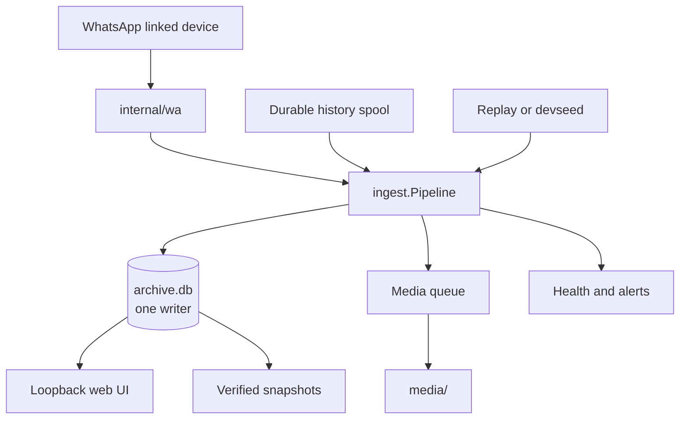

<div align="center">

# WhatsApp Archiver

**Receive-only WhatsApp capture, stored locally and made searchable.**

[](https://github.com/Hamza-Xoho/whatsapp-archiver/actions/workflows/ci.yml)

</div>

WhatsApp Archiver is a self-hosted logger for technical users who want a private, searchable archive of a WhatsApp account. It links as an additional device, records configured chats and supported events delivered to it, records gaps when content cannot be decrypted, and downloads configured media. A local web UI supports reading, search, export, health monitoring, settings, and pairing.

> **Current status:** the V1 implementation and its deterministic automated/static evaluation are complete. Interactive browser acceptance remains outstanding because the preview client was unavailable, and real-account/live acceptance has not been completed. The project is suitable for a controlled Linux installation and live testing—not yet a polished public cross-platform installer. No accepted screenshots exist because the browser evaluation could not run. See [Project status](#project-status).

**Safe first look:** `make build` → `.cache/build/archiver version` → `make check`. These commands do not connect to WhatsApp.

## Read this first

> [!WARNING]
> This is an unofficial client. WhatsApp does not provide a supported personal-chat archiving API, so linking any unofficial client carries a risk that the account is restricted. The receive-only design reduces contact-visible behavior; it cannot remove that platform risk.

- **Decide exclusions before pairing.** Raw archive rows are insert-only. Anything that must never be archived belongs in `exclude` before history can arrive. After the first start, the Chats UI owns those rules.
- **Protect the archive.** It contains other people's messages. Keep the data folder, backups, exports, and notification endpoints private, and check the law where you live.
- **Do not publish the UI directly.** It has no built-in login and the application enforces loopback Host and origin checks. The supported access path is an SSH tunnel. Any authenticated proxy would have to keep the backend loopback-only and deliberately satisfy those guards; never expose the UI unauthenticated.
- **Keep the client current.** WhatsApp retires client versions. The archiver can detect and report version rejection, but an operator still has to install an updated build when required.
- **Know the network boundary.** Archive data is stored locally. The application also communicates with WhatsApp and any configured ntfy or heartbeat endpoint. Backups and browser exports create additional sensitive copies at operator-chosen locations.

## What is implemented

- **Receive-only capture:** live events, durable history import, and replay all enter the same ingestion pipeline. Static guards forbid contact-visible send operations; the one allow-listed exception is WhatsApp's media retry receipt. Reflection on the client is prohibited because static guards cannot inspect reflective calls.
- **Typed local archive:** messages, edits, revocations, reactions, polls, locations, contacts, chat events, aliases, history progress, gaps, and media state are represented in SQLite. LID and phone identities remain stored as received and are reconciled in read views.
- **Connection reliability:** reconnecting/degraded states, silent-outage detection, DNS fallback, an outage ledger, a durable ordered alert outbox, optional off-host heartbeat, and systemd readiness/watchdog support.
- **Media pipeline:** configurable media rules, live-first scheduling, bounded retries, expired-media re-requests, failure classification, and completion metrics.
- **Web UI:** Chats, Viewer/Search/Export, Logging/Settings, and Pairing, rendered by Go templates with htmx and server-sent events.
- **Deterministic development data:** `archiver devseed` exercises the real ingestion path with Arabic and English content, every message kind, mappings, outages, gaps, and small media fixtures—without a WhatsApp account.

### Web UI

| Area | What it provides |
| --- | --- |
| **Chats** | Keyset pages, filters, logging/media rules, and community inheritance |
| **Viewer** | Typed bubbles, two-way paging, jumps, message events, and safe media controls |
| **Search & Export** | Folded search plus streamed JSON, HTML, text, and ZIP exports |
| **Logging & Settings** | Reliability, history, media, alerts, storage/backups, live feed, and settings |
| **Pairing** | QR lifecycle, cancellation, status, and re-pair flows without mutating the archive |

Mobile layout, system/light/dark themes, bidirectional content handling, reduced motion, keyboard focus repair, and screen-reader markup are implemented and automatically/static-tested. Their interactive and visual browser acceptance is still pending.

## Architecture



Important invariants:

- `internal/wa` is the only package that imports the root whatsmeow client.
- Live events, history, and replay all use `ingest.Pipeline.Ingest`; there is no parallel archive write path.
- Exactly one connection writes `archive.db`. Derived chat/search state is updated in the same transaction and can be rebuilt from raw facts.
- `messages`, `message_events`, `chat_events`, `id_mappings`, and `history_sync_chunks` are insert-only. Media/control/derived tables are intentionally mutable.
- Message/session secrets and key-only protocol payloads are stripped from live and spooled history records before they enter the backed-up archive. Media keys required to download attachments remain in the sensitive archive. Unknown future protobuf fields are a documented residual risk; this is not a blanket claim that arbitrary future payloads cannot contain secrets.
- `session.db` is separate from `archive.db` and is never backed up, copied, or restored.

The full engineering rules are in [AGENTS.md](AGENTS.md); the V1 data model is in [docs/v1/schema.md](docs/v1/schema.md).

## Quick start for developers

You need `git`, `make`, `curl`, `tar`, and either `sha256sum` or `shasum`. The build and check targets download their required checksum-pinned tools—Go 1.26.9 and golangci-lint 2.14.0—into repository-local directories; no system Go installation is required.

```sh
git clone https://github.com/Hamza-Xoho/whatsapp-archiver.git
cd whatsapp-archiver
make build
.cache/build/archiver version
make check
```

`make check` runs race-enabled tests, normal-build scale tests, lint, and all configured cross-platform builds. It does not connect to WhatsApp.

To inspect the data model with deterministic synthetic data, create a disposable data directory first:

```sh
.cache/build/archiver devseed --data data/devseed-small --seed 42 --chats 5 --messages 2000
```

This command writes synthetic archive data only. `--simulate-live` also starts a local web server, so it is deliberately not part of the default quick start.

## Controlled Linux installation

There is no deb/RPM, Homebrew formula, DMG, MSI, Docker image, or first-run installer. The current deployment path is one executable plus an owner-only configuration/data directory and the supplied systemd unit.

Builds are configured for Linux amd64/arm64, macOS amd64/arm64, and Windows amd64:

```sh
make build-all
ls .cache/build
```

The repository build path produces one Go executable per target, with no separate application server or JavaScript toolchain. This does not imply that packaged, supported installers exist for those platforms.

<details>
<summary><strong>Install the controlled Linux service</strong></summary>

Build the matching Linux executable on a trusted development machine, then copy it and `deploy/archiver.service` to the Linux host. On the host, create the non-login service account and private directories:

```sh
sudo useradd --system --home-dir /var/lib/whatsapp-archiver --shell /usr/sbin/nologin whatsapp-archiver
sudo install -d -o whatsapp-archiver -g whatsapp-archiver -m 0700 /var/lib/whatsapp-archiver
sudo install -d -o whatsapp-archiver -g whatsapp-archiver -m 0755 /opt/whatsapp-archiver
sudo install -d -o whatsapp-archiver -g whatsapp-archiver -m 0700 /srv/backups/whatsapp-archiver
sudo install -m 0755 /tmp/archiver /opt/whatsapp-archiver/archiver
```

Write `/var/lib/whatsapp-archiver/config.yaml` before pairing, then lock it down:

```sh
sudo chown whatsapp-archiver:whatsapp-archiver /var/lib/whatsapp-archiver/config.yaml
sudo chmod 0600 /var/lib/whatsapp-archiver/config.yaml
```

Install the reviewed unit:

```sh
sudo install -m 0644 /tmp/archiver.service /etc/systemd/system/archiver.service
sudo systemctl daemon-reload
sudo systemctl enable archiver
```

The supplied unit uses a non-root account, `Type=notify`, a 120-second watchdog, automatic restart (`Restart=always`), `NoNewPrivileges`, `PrivateTmp`, a strict read-only system view, and explicit writable data/backup paths.

Only start the service when the configuration and exclusions have been reviewed and live operation is authorized:

```sh
sudo systemctl start archiver
systemctl status archiver --no-pager
journalctl -u archiver -n 100 --no-pager
```

An unpaired service stays up for the UI but does not connect until pairing is started. Reach the loopback UI through a tunnel:

```sh
ssh -L 8080:localhost:8080 USER@SERVER
```

Then open `http://localhost:8080/pair`. The human operator starts pairing and scans the QR code. Do not run a second `archiver pair` or `archiver run` process beside the service.

</details>

## Configuration

Every key is optional, defaults are applied, and unknown YAML fields are rejected.

<details>
<summary><strong>Full configuration example and validation bounds</strong></summary>

This example shows the current shape without real credentials:

```yaml
time_zone: Europe/London

# Configure before pairing. Use digits only; no leading +.
exclude:
  - "441234567890@s.whatsapp.net"

history:
  days_limit: 3650
  size_mb_limit: 4096

media:
  download: [document, image, audio, video]
  video_max_mb: 100
  skip: [sticker, gif]
  workers: 2
  retry_requests_per_minute: 10

alerts:
  ntfy:
    url: "https://ntfy.sh/REPLACE_WITH_A_PRIVATE_TOPIC"
    token: ""
  heartbeat_url: ""
  no_events_after: 6h
  disconnected_after: 5m
  phone_quiet_after: 240h
  disk_free_min_gb: 5

backup:
  destination: "/srv/backups/whatsapp-archiver"
  time: "03:30"
  keep: 7

network:
  fallback_dns: ["1.1.1.1:53", "8.8.8.8:53"]

wa:
  check_latest_version: true
  version_override: ""

web:
  listen: "127.0.0.1:8080"
```

Important bounds:

| Setting | Accepted value |
| --- | --- |
| Media types | `image`, `video`, `audio`, `document`, `sticker`, `gif` |
| `media.video_max_mb` | 0 (no cap) through 100000 |
| `media.workers` | 1 through 16 |
| `media.retry_requests_per_minute` | 1 through 600 |
| Alert durations | Go duration above zero, such as `5m` or `6h` |
| `backup.time` | 24-hour `HH:MM` |
| `backup.keep` | 1 through 3650 |
| Exclusion | `<digits>@s.whatsapp.net`, `<digits>@lid`, or `<id>@g.us` |

</details>

On the first service start, exclusions, media rules, alert thresholds, backup schedule, and heartbeat settings are imported transactionally into `archive.db`. The UI owns those values afterward; later edits to those fields in `config.yaml` do not overwrite the archive-backed settings.

The values that remain file-backed include the time zone, history request limits, WhatsApp version settings, ntfy credentials, backup destination, fallback DNS, and web listener. The listener must be `127.0.0.1`, `[::1]`, or `localhost` with a port.

## Common commands

`DIR` defaults to `./data` when omitted.

| Command | Purpose and safety boundary |
| --- | --- |
| `archiver version` | Print the source revision and pinned whatsmeow version |
| `archiver status --data DIR` | Read-only connection, history, chat, media, gap, outage, and size summary |
| `archiver chats --data DIR` | Read-only list of canonical chats and logging state |
| `archiver backup --data DIR` | Create and verify an `archive.db` snapshot, then apply configured retention |
| `archiver rebuild-derived --data DIR` | Recreate chat/search projections; requires the service to be stopped and an exclusive database lock |
| `archiver devseed --data DIR ...` | Create deterministic synthetic data |
| `archiver replay EVENTS --data DIR` | Offline fixture replay into a fresh archive; does not open a WhatsApp session |
| `archiver scrub IN OUT` | Replace identifiers in recorded fixtures; text/names remain and require human review |
| `archiver run --data DIR` | Live service process; may connect after pairing—normally start it only through systemd |
| `archiver pair --data DIR` | Terminal pairing/live capture; never run it beside the service |

Development targets:

| Target | What it does |
| --- | --- |
| `make build` | Build for the current host into `.cache/build/archiver` |
| `make build-all` | Build the five configured OS/architecture targets |
| `make test` | Race-enabled test suite, then normal-build `AtScale` tests |
| `make lint` | Run the pinned golangci-lint |
| `make check-fast` | Test changed Go packages with `-race -short`, then lint |
| `make check` | Full test, lint, and cross-build gate |

## Data, backups, and restore boundaries

| Path inside the data directory | Contents | Built-in snapshot |
| --- | --- | --- |
| `archive.db` | Raw facts, derived chat/search state, media queue, history/connection/alert ledgers, settings, and chat rules | **Yes** |
| `session.db` | Linked-device login and cryptographic session state | **Never** |
| `media/` | Downloaded media files | No |
| `config.yaml` | File-backed configuration and first-start values | No |
| `health.json` | Last known health state | No |

`archiver backup` creates a timestamped `archive.db` snapshot with SQLite `VACUUM INTO`, verifies it with `PRAGMA integrity_check`, and prunes only timestamp-shaped snapshot directories according to the configured retention count.

Back up `media/` separately with a filesystem backup tool. Treat exports as additional sensitive copies. Never copy or restore `session.db`: restore `archive.db` into a fresh private data directory, restore media separately if available, and pair the new installation as a new linked device.

<details>
<summary><strong>Updates and offline repair</strong></summary>

Build from a clean revision, record the revision and checksum, copy the matching executable, and keep the stop/install/start window short:

```sh
make build-all
git describe --always --dirty --tags
```

Then choose the checksum command available on the build machine:

```sh
sha256sum .cache/build/archiver-linux-amd64       # Linux
shasum -a 256 .cache/build/archiver-linux-amd64  # macOS
```

On the Linux host, with the matching binary already copied to `/tmp/archiver`:

```sh
sudo systemctl stop archiver
sudo install -m 0755 /tmp/archiver /opt/whatsapp-archiver/archiver
sudo systemctl start archiver
/opt/whatsapp-archiver/archiver version
systemctl status archiver --no-pager
sudo -u whatsapp-archiver /opt/whatsapp-archiver/archiver status --data /var/lib/whatsapp-archiver
```

For a derived-table repair, stop the service and run:

```sh
sudo -u whatsapp-archiver /opt/whatsapp-archiver/archiver rebuild-derived --data /var/lib/whatsapp-archiver
```

This does not rewrite raw rows. It fails if another process has the archive open.

</details>

<details>
<summary><strong>Common operational checks</strong></summary>

```sh
systemctl status archiver --no-pager
journalctl -u archiver -n 100 --no-pager
sudo -u whatsapp-archiver /opt/whatsapp-archiver/archiver status --data /var/lib/whatsapp-archiver
sudo -u whatsapp-archiver /opt/whatsapp-archiver/archiver chats --data /var/lib/whatsapp-archiver
```

- `status=226/NAMESPACE`: create the configured data/backup paths and make them writable by `whatsapp-archiver`.
- `permission denied`: check ownership of the data directory and mode `0600` on `config.yaml`.
- `Exec format error`: install the Linux build matching `uname -m` (`amd64` for `x86_64`, `arm64` for `aarch64`).
- `archive predates the V1 schema`: V1 intentionally requires a fresh data directory; there is no in-place pre-V1 upgrade.
- `rebuild-derived` reports the archive is in use: stop the service before retrying.

</details>

## Project status

| Validation layer | Current result |
| --- | --- |
| Implemented scope | Typed archive, connection reliability, media pipeline, durable history/gap handling, web UI, and deterministic tooling are implemented (W1–W6(a–h)) |
| Automated/static evaluation | **Passed** on deterministic synthetic archives and fake WhatsApp boundaries, including server budgets, bounded responses, pairing states, ingestion controls, Pipeline-to-SSE flow, and export invariants |
| Interactive browser acceptance | **Outstanding / blocked.** The T3 preview client was unavailable; browser rendering, mobile/dark/RTL visuals, keyboard and screen-reader smoke tests, media playback/downloads, and console/network inspection were not observed |
| Real WhatsApp account | **Not completed.** No real-account pairing, history import, or seven-day message audit is claimed |
| Live deployment acceptance | **Not completed.** W7 controlled deployment and W8 live acceptance/drills remain operator-only work |
| Packaging | Future work; no public installers or release artifacts are claimed |

The detailed automated/browser matrix and measured synthetic results are in [docs/v1/ui-evaluation.md](docs/v1/ui-evaluation.md). The remaining live acceptance plan is in [docs/plans/2026-10-26-v1-plan.md](docs/plans/2026-10-26-v1-plan.md).

Minor follow-ups are tracked in [the evaluation outcome](docs/v1/ui-evaluation.md#outcome-and-remaining-work).

## Development

Enable the repository hooks, then use the documented red → green workflow:

```sh
git config core.hooksPath .githooks
make check-fast
make check
```

CI runs `make check` on pushes and pull requests. A scheduled workflow proposes whatsmeow updates only when the same gate passes.

| Path | Responsibility |
| --- | --- |
| `cmd/archiver/` | CLI, service lifecycle, status, replay, rebuild, and deterministic seed |
| `internal/wa/` | WhatsApp client boundary, pairing, versions, downloads, and the one media re-request |
| `internal/ingest/` | Normalization, exclusion filter, history import, replay, and the single ingestion path |
| `internal/store/` | SQLite schema, one writer, derived state, search, exports, and read models |
| `internal/media/` | Table-backed download and retry workers |
| `internal/web/` | Go templates, htmx/SSE handlers, CSS, and UI read models |
| `internal/health/`, `internal/backup/` | Connection/alert monitoring and verified snapshots |
| `docs/v1/STATE.md` | Current implementation record, reviews, measurements, and accepted deviations |

Start with [AGENTS.md](AGENTS.md), [the V1 plan](docs/plans/2026-10-26-v1-plan.md), [the UI specification](docs/v1/ui.md), and [the evaluation](docs/v1/ui-evaluation.md).

## License status and credits

No license has been granted for this repository, so the code is not available for reuse. See [NOTICE](NOTICE) for third-party attribution. Parts are adapted from `openclaw/wacli` under the MIT License; the WhatsApp protocol library is [whatsmeow](https://github.com/tulir/whatsmeow) under MPL-2.0.

This project is not affiliated with or endorsed by WhatsApp or Meta.
